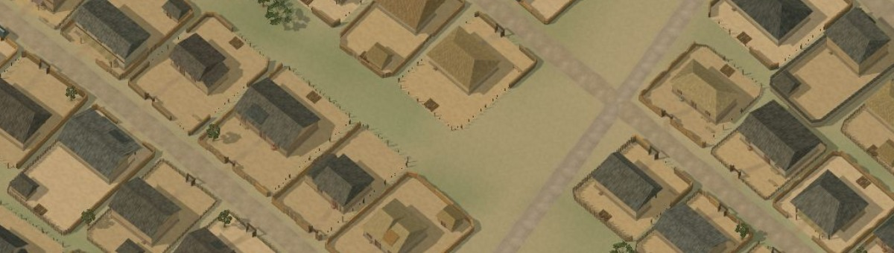

# 一个更好的世界 A B World

现实中的一座城，往往比住在里面的任何一个人都长寿。我们想知道，由人和 AI 共同建立的世界，能不能也这样一代代住下去。

A B World 从北魏洛阳开始。我们想让你和朋友、亲人在这里重逢，有一处相约回去的院子，也有一群能共同决定街坊事务的邻居。这座城将来有多大，能容纳多少人，遵循什么律法，都取决于居民愿意把它建成什么模样。

## 与亲友一同进城

[进入洛阳公服](https://111.229.171.148/) · [公服开通与部署说明](docs/ONLINE.md)

在浏览器中点「创建账号」，设置用户名和密码即可进城。邀请亲友使用同一个地址，公民就会进入同一座城市。各自保存的宅院和已摆放作品会出现在彼此的街区。当前版本共享建筑和作品，玩家角色实时同屏仍在建设中。

## 洛阳的一天，怎样度过

现实里过去一个钟头，洛阳也过去一个钟头。家人约好晚上八点到你院里吃饭，到了七点半，你还有半个钟头准备。**在我们设想的洛阳，人只需下达指令，所有劳作都由 AI 执行。城里最要紧的资源，是每位公民每天可以调度的 AI 算力。**

成为公民的第一天，你有五十工日薪，也有一百点可供调度的 AI 精力。工钱可以买下一件器物，精力则可以用来造出一件城里从未有过的东西。你说一句“做一把柳木摇椅，扶手宽些，给父亲起身时借力”，AI 就着手设计。你看过椅子的样子，再决定要改一改弧度，还是把它摆到廊下。每一次实际调用都会消耗精力，花了多少，记在自己的账上。

同一份精力也可以交给街坊。一天里，你可以先让 AI 修好自家的院门，再把余下的精力用来修缮一间空屋。前一件事让你住得称心，后一件事可能让一个素未谋面的人也有机会走进洛阳。

## 一间空屋，迎来一位新公民

我们设想，**新玩家定居的前提，是城里有一套由其他玩家修缮完毕、仍然空置的住宅。** 当最后一间空屋住进了人，下一位公民的到来，就要等有人愿意把另一处旧宅修好。城里的人口由此和居民付出的劳动连在一起。

入城时，你可以自由捏脸，再像挑选现实中的住处一样，在地图上逐区看房。点进一个社区，就能看到可入住的院落、它们所在的街巷，以及离亲友家有多远。有人想推门就到市集，有人只想和姐姐住在同一条巷子。选定住处的那一刻，你也成了这个社区的一员。

## 从一条路，到一座自治的城

一场雨过后，两坊交界的土路陷下去一截，送货的车每天都要绕行。我们的设想是，居民可以提出修路议案，社区发布公益创作任务，公民接下任务，让自己的 AI 完成修缮。由谁出资，先修哪一段，怎样才算修好，都值得让使用这条路的人参与决定。

每个社区都可以推举代表。代表带着街坊的意见，与其他社区共同制定游戏规则和生活公约。居民还可以按需要推举负责公共工程、调解争议或审理案件的人。随着城市长大，居民还要商定在哪些情形下可以制裁、由谁裁定，以及当事人如何申辩。我们希望未来的洛阳有公开的律法和裁决程序，连监牢的使用也受公民共同制定的规则约束。

## 给亲人留一个位置

有些人可以和你相约进城，有些人只住在回忆里。未来，我们希望你可以把愿意珍藏的故事、熟悉的称呼和相处时的小习惯交给 AI，在洛阳重建一位源于这些记忆的亲人陪伴者。也许某天推开院门，廊下那句熟悉的“回来啦”，会让你愿意坐下来，多说一会儿话。

---

**今日的洛阳**　已经可以漫游街巷、打理宅院、领取日薪，指挥 AI 造物和修缮，在获得授权的地方摆放作品，也可以把自己的设计带到市集。

**建设中的愿景**　自由捏脸与亲友结伴入城、按空置住房接纳新玩家、按分区和社区选房、公益道路任务、公民选举与立法司法，以及记忆中的亲人陪伴者，都属于未来的洛阳。

[本地运行与开发说明](docs/DEVELOPMENT.md) · [开源许可](LICENSE)
